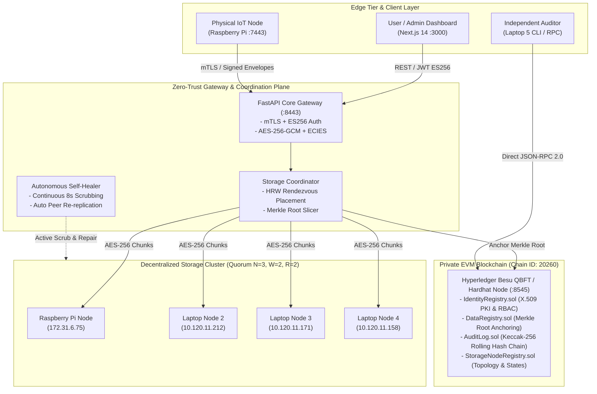

<div align="center">

# 🛡️ SecureNodeX

### Decentralized, ECC-Secured Zero-Trust Edge Storage & Cryptographic Audit Platform

[](https://soliditylang.org/)
[](https://fastapi.tiangolo.com/)
[](https://nextjs.org/)
[](https://besu.hyperledger.org/)
[](https://www.docker.com/)
[](LICENSE)

<br/>

**[Architecture](#-system-architecture)** •
**[Key Features](#-core-features)** •
**[Smart Contracts](#-smart-contract-security-suite)** •
**[Live Demo](#-live-demo-script-for-judges)** •
**[Quick Start](#-quick-start--installation)** •
**[Team](#-team-codecommit)**

</div>

---

> [!NOTE]
> **Smart India Hackathon 2026** | **Problem Statement: 26125** | **Team CodeCommit**  
> *SecureNodeX eliminates single points of failure in edge computing by uniting Zero-Trust PKI, private EVM blockchain consensus, and decentralized replicated edge storage across real hardware devices.*

---

## 🏛️ System Architecture



---

## ⚖️ SecureNodeX vs. Traditional Cloud Storage

| Capability | Traditional Centralized Cloud (AWS S3 / GCP) | SecureNodeX Decentralized Platform |
| :--- | :--- | :--- |
| **Trust Model** | Blind trust in single cloud provider / admin | **Zero-Trust**: Mutual TLS, ECC P-256 keys & digital signatures |
| **Data Integrity** | Vulnerable to silent root-admin tampering | **Immutable**: Merkle roots anchored on-chain with instant detection |
| **Audit Trails** | Database logs can be altered or erased | **Tamper-Evident**: Keccak-256 rolling hash chain on EVM ledger |
| **Availability** | Server outage takes down the bucket | **High Availability**: Quorum replication ($N=3, W=2, R=2$) across nodes |
| **Failure Recovery**| Manual backups or cloud sync required | **Autonomous Self-Healing**: Background daemon repairs wiped chunks in <10s |
| **Hardware Realism**| Abstract data centers | **Multi-Device Cluster**: Runs on physical Raspberry Pi & edge laptops |

---

## 🌟 Core Features

### 1. 🔐 Zero-Trust Hardware PKI & Cryptography
* **Asymmetric Elliptic Curves:** Uses **NIST P-256 (secp256r1)** for device certificates and **secp256k1** for EVM blockchain transactions.
* **Double-Layer Authenticity:** Transport security enforced via **mutual TLS (mTLS)**; data non-repudiation enforced via per-packet ECDSA signatures.
* **No Shared Secrets:** User session tokens are asymmetric JWTs signed via **ES256 ECDSA** (private key signs, public key verifies).

### 2. ⛓️ Enterprise EVM Blockchain (Chain ID: 20260)
* **Consensus Engine:** **Hyperledger Besu (QBFT)** / Hardhat EVM execution layer with instant deterministic finality (zero forks, zero reorgs).
* **Zero-Fee Economic Model:** $0 gas price allows continuous edge IoT telemetry and audit anchoring without crypto token friction.
* **Event-Driven Mining:** Blocks are sealed on demand when state transitions occur, avoiding empty ledger bloat.

### 3. 💾 Decentralized Split & Replicated Storage
* **Off-Chain Chunks, On-Chain Roots:** Large encrypted payloads live on distributed nodes; only lightweight 32-byte SHA-256 Merkle roots anchor on-chain.
* **Dual Encryption:** Payloads encrypted with **AES-256-GCM**; Data Encryption Keys (DEKs) wrapped with **ECIES** (Elliptic Curve Integrated Encryption Scheme).
* **Autonomous Self-Healing Daemon:** `tools/auto_healer_daemon.py` continuously scrubs disk integrity every 8 seconds, automatically pulling missing replicas from peer nodes if local storage is wiped.

### 4. 🖥️ Modern High-Contrast Light Dashboard
* Built with **Next.js 14**, Tailwind CSS, and Lucide icons.
* Role-specific persona views: **Admin**, **Manager**, **Auditor**, and **Standard User**.
* Interactive audit chain verification recalculating Keccak-256 rolling proofs directly in the browser.

---

## 📜 Smart Contract Security Suite

All 5 core contracts are compiled with **Solidity 0.8.24 (Cancun Fork)** with 200 optimizer runs.

```text
  AssetRegistry Contract
    ✔ should mint asset and assign custodial address owner
    ✔ should allow policy-checked asset transfer between active users
  AuditLog Contract
    ✔ should initialize with head = 0 and seq = 0
    ✔ should record events and match off-chain hash chain recomputation
  DataRegistry Contract
    ✔ should register object and verify read permissions
    ✔ should anchor telemetry batch and enforce anchor immutability
  IdentityRegistry Contract
    ✔ should enforce bootstrap registration and record admin count
    ✔ should allow Admin to register Manager, Device, and User
    ✔ should enforce that REVOKED is terminal and cannot be reinstated
  Role Matrix & Fuzzing Suite
    ✔ Random role bitmasks without ADMIN bit never escalate to ADMIN operations
  StorageNodeRegistry Contract
    ✔ should allow Admin to register storage node if node identity has STORAGE_NODE role

  24 passing (1s) | Solc 0.8.24 | Max deployment consumes only 4.1% of block gas limit
```

| Smart Contract | Purpose | Block Gas % | Security Invariant |
| :--- | :--- | :---: | :--- |
| **`IdentityRegistry`** | Device & User Identity Registry | `2.5%` | Prevents revoking last admin; terminal revocation. |
| **`DataRegistry`** | Merkle Root & Access Control | `2.5%` | Verifies read permissions & anchors telemetry batches. |
| **`StorageNodeRegistry`**| Node Topology & Health | `2.4%` | Enforces `STORAGE_NODE` identity verification. |
| **`AuditLog`** | Immutable Append-Only Ledger | `0.7%` | Enforces Keccak-256 rolling hash chain integrity. |
| **`AssetRegistry`** | Custodial Asset Management | `4.1%` | Enforces custodial ownership and role-checked transfers. |

---

## ⚡ Quick Start & Installation

### 1. Clone the Repository
```bash
git clone https://github.com/shankumar7/SecureNodex7.git
cd SecureNodex7
```

### 2. Launch Supporting Services via Docker
```bash
docker compose -f deploy/docker-compose.yml up -d
```

### 3. Run Smart Contract Tests & Start Blockchain
```bash
# Terminal 1: Run comprehensive 24-test suite
cd contracts && npx hardhat test

# Terminal 2: Start EVM RPC Node
npx hardhat node --hostname 0.0.0.0
```

### 4. Start the Web Dashboard
```bash
cd dashboard
npm install
npm run dev
# Access UI at http://localhost:3000
```

---

## 🎬 Live Demo Script for Judges

### 1. Show the Live Cluster
* Open `http://localhost:3000` on Laptop 1.
* In **Decentralized Storage**, show that the storage nodes include the **physical Raspberry Pi (`172.31.6.75:7443`)** and multiple teammate laptops.

### 2. Live Cryptographic Upload
* Click **"Upload Object"** to upload any PDF or document.
* Show that the file is encrypted (AES-256-GCM + ECIES), sliced, and replicated across the Pi and laptop nodes.

### 3. Verify Hardware Reality (Raspberry Pi)
* Open an SSH terminal to the Pi:
  ```bash
  ssh shankumar@172.31.6.75
  ls -la /tmp/snx_storage_data
  ```
* Show the raw SHA-256 content-addressed chunk files sitting on the physical SD card.

### 4. Independent Blockchain Audit (Laptop 5)
* On Laptop 5, query the EVM RPC directly without using the web UI:
  ```bash
  RPC_URL=http://<CONTROLLER_IP>:8545 python3 tools/show_block.py
  ```
* Shows the live block height, timestamp, transaction hash, and ECDSA signature.

### 5. Chaos Engineering & Autonomous Self-Healing
* **Tampering Attack (Laptop 6):**
  ```bash
  python3 tools/chaos/tamper.py
  # Result: Gateway flags SIGNATURE_INVALID and drops malicious packet
  ```
* **Disk Failure & Auto-Healing (Raspberry Pi):**
  ```bash
  # Wipe all chunks on the Raspberry Pi
  rm -rf /tmp/snx_storage_data/*
  
  # Within 8 seconds, the background auto-healer daemon detects the loss,
  # fetches the surviving replicas from the laptops, and restores the Pi!
  ls -la /tmp/snx_storage_data  # Files automatically back!
  ```

---

## 👥 Team CodeCommit

<div align="center">

| Avatar | Contributor | Role & Responsibility | GitHub |
| :---: | :--- | :--- | :---: |
|  | **Shashank Kumar** | **Team Lead & System Architect**<br/>Core Architecture, Gateway Pipeline, Coordinator | [@shankumar7](https://github.com/shankumar7) |
|  | **D Rithwik** | **Frontend Engineering & UI/UX**<br/>Next.js 14 Dashboard, High-Contrast Light Theme | [@rithwikd-07](https://github.com/rithwikd-07) |
|  | **Ezaz Ali** | **Backend APIs & Infrastructure**<br/>FastAPI Services, DB Models, Root CA & PKI | [@ezazali-14](https://github.com/ezazali-14) |
|  | **Dheeraj Pusuluri** | **Smart Contracts & Consensus**<br/>Solidity 0.8.24 Suite, Besu QBFT, Hardhat Suite | [@DheerajPusuluri](https://github.com/DheerajPusuluri) |
|  | **Dinesh Kumar** | **Edge Computing & Storage Daemon**<br/>snx-storage Engine, Raspberry Pi Deployment | [@Dinesh2006kumar](https://github.com/Dinesh2006kumar) |
|  | **Shruthi Peddapuram** | **Security QA & Cryptographic Audit**<br/>Chaos Engineering, Fuzzing Tests, Verification | [@shruthi-peddapuram](https://github.com/shruthi-peddapuram) |

</div>

---

## 📄 License

This project is licensed under the **MIT License** — see the [LICENSE](LICENSE) file for details.

```text
Copyright (c) 2026 Shan Kumar
```
